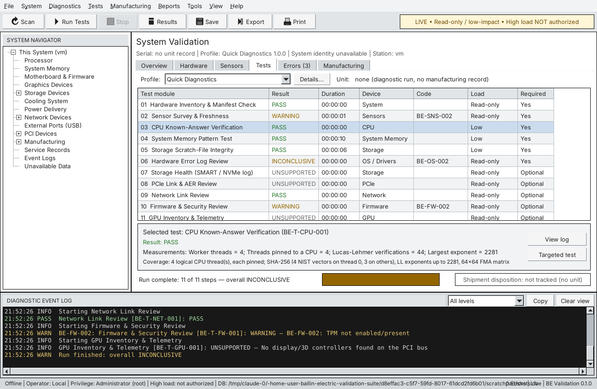

# Ballin Electric System Validation Suite

Rust-first OEM hardware diagnostics, stability testing, factory burn-in, fault isolation and manufacturing quality assurance.

Status: **early development build (engine 0.1.0).** Milestones 0–2 are implemented, and Milestones 3–5 are partial. Everything is tested with fixtures and run live only on a cloud Linux development VM. **No feature has been validated on physical BE-01 hardware, on any physical workstation, or on Windows.** No hardware certifications are implied. See [Development Status](docs/Development%20Status.md) and the [Capability Matrix](docs/Capability%20Matrix.md).

## Start here

1. Read [CLAUDE.md](CLAUDE.md) for coding-agent instructions.
2. Read [Development Specification](docs/Development%20Specification.md) in full.
3. Review the [Design Language](design/Design%20Language.md) and [design tokens](design/Design%20Tokens.json).
4. Review the visual reference below and begin Milestone 0.
5. Keep [Development Status](docs/Development%20Status.md) and [Third Party Notices](docs/Third%20Party%20Notices.md) up to date.

## Quick start

```bash
cargo build --release --workspace
```

```bash
./target/release/bevalidate-gui
```

```bash
./target/release/bevalidate run --profile quick --output ./results
```

Native build dependencies and Windows notes: [Build](docs/Build.md). CLI reference and exit codes: [CLI](docs/CLI.md). Safety design: [Safety](docs/Safety.md). Architecture and decisions: [Architecture](docs/Architecture.md). Fault codes: [Fault Codes](docs/Fault%20Codes.md). Accessibility findings: [Accessibility](docs/Accessibility.md).

Genuine screenshot of the running application: BE Validation 0.1.0, Ubuntu 24.04 cloud development VM (virtualized, not physical hardware), Linux under Xvfb, Quick Diagnostics with live readings from that VM (no fixture data). The VM exposes no sensors, so the outcome is correctly *not* releasable:



## Workspace layout

| Path | Contents |
| --- | --- |
| `crates/be-core` | Status semantics, results, fault catalog, profiles, release policy, IPC protocol |
| `crates/be-platform` | Linux sysfs/procfs and Windows CIM providers, NVML adapter |
| `crates/be-diagnostics` | Test modules |
| `crates/be-worker` | `bevalidate-worker` isolated test process (plus integration tests) |
| `crates/be-safety` | Supervisor, safety policy, sensor watchdog |
| `crates/be-storage` | SQLite repository and migrations |
| `crates/be-reporting` | HTML / JSON / CSV reports |
| `crates/be-engine` | Profile runner and release review shared by GUI and CLI |
| `crates/be-cli`, `crates/be-gui` | `bevalidate` and `bevalidate-gui` |
| `profiles/` | Versioned test profiles; `profiles/safety/` example (not approved) safety profile |
| `packaging/` | Unsigned release build scripts |
| `docs/` | Specification, status, architecture, capability matrix, notices, SBOM |

## Approved visual direction

Traditional, dense industrial desktop software: native-style menus, expandable device tree, tabbed details, sortable data tables, console logs and restrained colors. No webview, SaaS dashboards, rounded cards or decorative gradients.


The screenshot is an original static specification mockup, not the running software. The data is fictional and must not be used as a production diagnostic result.

## Technical foundation

Rust (edition 2024), Cargo, FLTK-rs (initial GUI toolkit), SQLite via rusqlite, typed platform providers and isolated test workers. Windows and Linux are target platforms, not verified support claims. Vendor APIs, graphics kernels, licensing and hardware compatibility must be verified during implementation.

## Development and safety

Do not start physical stress tests, install privileged drivers, flash firmware, change voltages, write to raw disks or publish releases without appropriate authorization. Start with read-only inventory, known-answer low-impact tests and fixtures. Required tests that fail or cannot run must block factory release. The software does not replace electrical safety certification or calibrated instruments.

## Repository setup

Extract this folder. Use its contents as the repository root. For a new repository, upload the contents through GitHub's Add file > Upload files, or initialize Git locally and push to a repository you control. Prefer a private repository while intellectual property and commercial plans are being reviewed. Do not commit customer records, diagnostic logs or signing keys.

No project license has been selected. Do not assume this package grants third parties open-source rights. Confirm ownership and select a license before external distribution.
